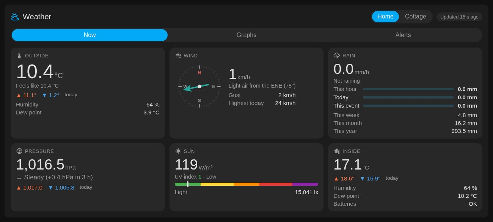
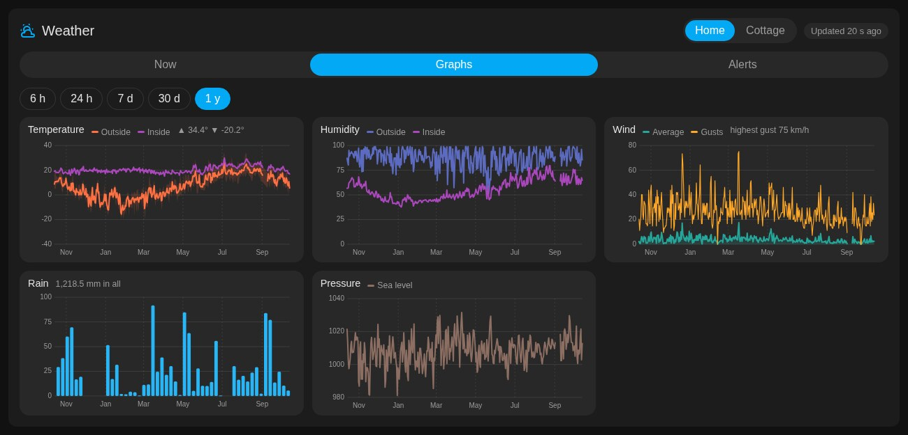
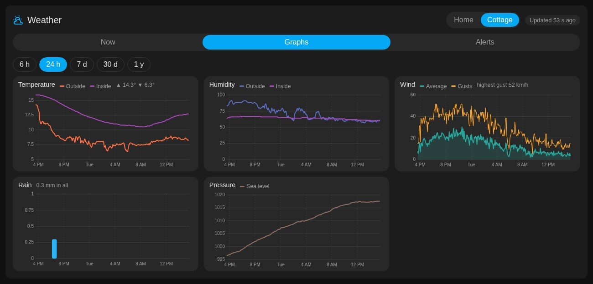
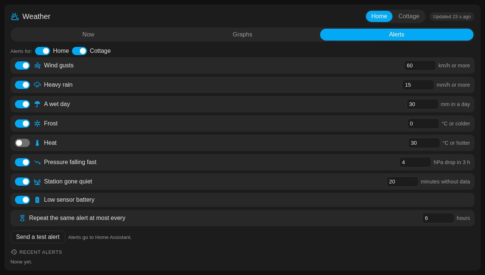

# ecowitt-monitor + Ecowitt card

A dashboard, a Home Assistant card and alerts for **Ecowitt weather stations** (HP2551 and friends: any console or
gateway that HA's core **Ecowitt** integration reads). One or several stations, say home and a cottage, each in its
own Home Assistant, switched with a button.





| | |
|---|---|
|  |  |

- **Now**: outside temperature, feels-like and wind chill, today's high and low, humidity and dew point; a wind compass
  (the arrow points the way the wind blows) with speed, Beaufort description, gust and today's highest gust; rain rate,
  this hour, today, this event, week, month and year; pressure with today's range and its 3-hour tendency (steady,
  rising, falling fast...); solar radiation, UV index on the WHO scale, light; inside temperature, humidity and dew
  point; sensor batteries.
- **Lightning** (if that Home Assistant has the [Blitzortung](https://github.com/mrk-its/homeassistant-blitzortung)
  integration, from HACS): the last hour's strikes on a satellite map centred on that HA's home location (Esri World
  Imagery with place names; range rings at 10, 25, 50 and 100 km; zoom to 25, 50 or 100 km; newest brightest), strikes in the last 15 minutes and hour, the nearest and the latest, a strike-count graph, and a
  "lightning within X km" alert.
- **Radar**: Environment Canada's rain and snow radar ([MSC GeoMet](https://eccc-msc.github.io/open-data/msc-geomet/readme_en/),
  free, no key) on the same satellite map, centred on the station, the last hour looped (play / pause), zoom 50, 100,
  250, 500 or 1,000 km. Canada and the northern US border only: that's where the radar network is.
- **Graphs**: temperature (outside with its min-max band, inside), humidity, wind (average and gusts), rain (bars:
  30 min, hourly, 6-hourly, daily or weekly to suit) and pressure, over **6 h, 24 h, 7 d, 30 d or a year**. Touch or
  hover for values. History comes from Home Assistant's own statistics, so a year of graphs is there from day one.
- **Moon**, on the Graphs tab: tonight's phase drawn, % illuminated, age, moonrise and moonset at the station, the next
  full and new moons, and a chart of the illumination over the chosen range (calculated with
  [SunCalc](https://github.com/mourner/suncalc)'s formulas, no data source needed).
- **Alerts**: wind gusts, heavy rain, a wet day, frost, heat, pressure falling fast (a storm coming), a station gone
  quiet, a low sensor battery, lightning nearby. Thresholds and on/off on the card, per station; the same alert at most every few hours.
  Sent to a Home Assistant webhook (phone, watch, a spoken announcement: see [`ha-automation.yaml`](ha-automation.yaml))
  and/or [ntfy](https://ntfy.sh).
- **Home Assistant add-on**: on HA OS, add [`jchisholm59/ha-addons`](https://github.com/jchisholm59/ha-addons) to the
  Add-on Store and install **Ecowitt Monitor**: a **Weather** panel in the sidebar, no token needed for HA's own station.
- **Standalone**: the same card at `http://<this machine>:7120/`, no Home Assistant dashboard needed (it still reads
  the station through HA). `?station=cottage&tab=graphs&range=7d` opens it there.

## How it works
`ecowitt-monitor` (Node.js 22+, no dependencies) connects to each station's Home Assistant over its websocket API with a
long-lived access token, finds the Ecowitt sensors (by their unique IDs, so renamed entities are fine), follows their
states live and asks HA's recorder for statistics: 5-minute ones for 6 h and 24 h (HA keeps those 10 days by default),
hourly for 7 d and 30 d, daily for a year. Values are shown in metric whatever units HA uses. The card and the
standalone page get everything from the monitor, so the token never reaches a browser.

Rain history uses the change in the **monthly** rain total, which follows the yearly total exactly; a negative change
(a counter reset, say after replacing the rain gauge) is ignored.

## Install
**The monitor**, on any always-on machine that can reach Home Assistant:
```bash
git clone https://github.com/jchisholm59/ecowitt-monitor.git
cd ecowitt-monitor && ./install.sh
```
It checks Node.js 22+, installs pm2 if needed, asks for HA's address, a token (HA: your profile → Security →
Long-lived access tokens), alerts, and starts the monitor under pm2. For several stations, see `STATION_1_...` in
[`.env.example`](.env.example).

**Updating**: `cd ecowitt-monitor && git pull && ./install.sh --yes` (keeps `.env` and `data/`).

**The card**: copy `dist/ecowitt-card.js` to `/config/www/` on Home Assistant, add `/local/ecowitt-card.js` under
Settings → Dashboards → ⋮ → Resources (JavaScript module), then a view (a *Panel* view suits it) with:
```yaml
type: custom:ecowitt-card
monitor:                              # the first that answers is used
  - http://192.168.1.20:7120
  - http://100.64.0.10:7120           # optional: over Tailscale/VPN, for away from home
station: home                         # optional: which station to open on
```
HA over plain `http` on your LAN: if your HA is `https`, the card can't call an `http` monitor (mixed content), so put
the monitor behind https too.

**Alerts**: create the automation in [`ha-automation.yaml`](ha-automation.yaml), put its webhook in `.env` as
`HA_WEBHOOK`, restart (`pm2 restart ecowitt-monitor --update-env`), then **Send a test alert** on the Alerts tab.

## API
| | |
|---|---|
| `GET /api/status` | each station: connected, readings, seconds since its last reading |
| `GET /api/stations` | the stations |
| `GET /api/live?station=` | current values (metric), today's highs and lows, 3-hour pressure change, batteries |
| `GET /api/history?station=&range=` | `6h`, `24h`, `7d`, `30d`, `1y`: aligned series from HA's statistics |
| `GET / PUT /api/settings` | alert settings (partial updates; with `ADMIN_PASSWORD`, sign in to change) |
| `GET /api/alerts` | the last 100 alerts |
| `POST /api/test-alert?station=` | send a test |

## License
MIT
